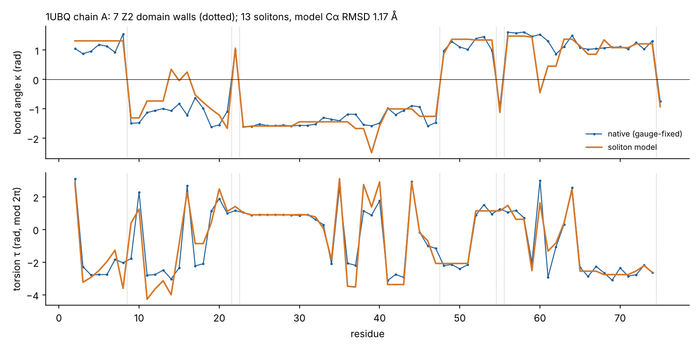

# higgsfold

**Soliton and local-topology analysis of protein backbones.** Give it a PDB ID, an AlphaFold
accession, a structure file or an MD trajectory. It describes the Cα backbone the way
A. J. Niemi and co-workers do in their field-theory approach to proteins:

* **Discrete Frenet frames:** the backbone becomes a sequence of bond angles κ and torsions τ.
  The chain can be rebuilt from (κ, τ) exactly, and the package checks this on every run.
* **Z2 gauge symmetry:** flipping the sign of κ and shifting τ by π leaves the chain unchanged.
  Fixing this gauge (in an Abelian Higgs-like picture) splits the chain into domains of opposite
  sign. The **domain walls** between them mark the loops, and helices and strands have none.
* **Solitons:** loops are modelled as kinks (dark solitons) of a discretized nonlinear
  Schrödinger equation. The fit places solitons adaptively and then refines them all together
  against the backbone. Ubiquitin is rebuilt to **1.17 Å Cα RMSD** from 13 solitons (130 parameters). A generic
  cosine basis with the same 130 parameters does better (0.47 Å); see [Fit accuracy](#fit-accuracy).
* **Local topology and perestroikas:** flattening points (τ crosses 0), branch points (τ crosses ±π),
  the correlation function C(k), and the folding index, following Begun, Chernodub, Molochkov & Niemi,
  *Phys. Rev. E* 111, 024406 (2025).
* **Ensembles:** perestroika statistics across the frames of an MD trajectory (through MDAnalysis).
  These show where local topology changes during a conformational transition. NMR model ensembles are not
  supported yet.

> This is an independent re-implementation for learning and exploration. It is not the
> authors' code. Where the paper leaves choices open, they are documented below.

## Install
```bash
git clone https://github.com/mantiswriter/higgsfold.git && cd higgsfold
pip install -e ".[fast]"        # core + numba (recommended: fitting is ~100x faster)
pip install -e ".[fast,md]"     # + MD trajectories
```
Or open `notebooks/higgsfold_colab.ipynb` in Google Colab (its first cell is preset to `mantiswriter`).

## Quick start
```bash
higgsfold analyze 1UBQ --out results/            # PDB ID, AlphaFold accession, or a .pdb/.cif path
higgsfold analyze 1UBQ --fast                    # quicker, less accurate soliton fit
higgsfold analyze 1UBQ --baseline                # also fit a generic cosine basis with the same parameter count
higgsfold analyze 1UBQ --model paper             # the paper's torsion law instead of the two-field kink
higgsfold ensemble topology.psf trajectory.dcd   # perestroika statistics over a trajectory
```
```python
import higgsfold as hf
res = hf.analyze("1UBQ")
res["n_domain_walls"], res["topology"]
```
Outputs: a per-residue CSV (κ, τ, gauge-fixed values, domain walls, crossing type, landscape region),
a JSON summary, the rebuilt soliton-model Cα PDB, and figures.

## Example: ubiquitin (1UBQ)


* 76 residues. Rebuilding the backbone from (κ, τ) matches to 2×10⁻¹⁴ Å.
* The smooth gauge gives 7 domain walls, all in loops and turns. The α-helix (residues 23–34)
  and the β-strands have none.
* 13 solitons (7 at domain walls, 6 added adaptively) rebuild the whole backbone to **1.17 Å
  Cα RMSD**, with a median of 0.79 Å per soliton window.

## Fit accuracy
Whole-backbone Cα RMSD of the rebuilt soliton model (default settings, `two-field`, 1500 global iterations),
next to a **baseline with the same number of parameters and the same refinement budget**: the gauge-fixed κ and τ
profiles expanded in a cosine basis and refined against the whole backbone (`--baseline`). Raw output is in
[`results/`](results/).

| Protein | Residues | Domain walls | Solitons | Soliton params | **Soliton RMSD** | **Cosine baseline, same params** | Params at a bound* |
|---|---|---|---|---|---|---|---|
| Ubiquitin (1UBQ) | 76 | 7 | 13 | 130 (raw κ,τ: 147) | 1.17 Å | **0.47 Å** | 5 / 104 |
| Ubiquitin, walls only (`--target 99`) | 76 | 7 | 7 | 70 | 2.88 Å | **1.70 Å** | 4 / 56 |
| HIV-1 protease (1HVR, chain A) | 99 | 9 | 12 | 120 (raw: 193) | 2.28 Å | **1.29 Å** | 5 / 96 |
| Adenylate kinase (4AKE, chain A) | 214 | 13 | 20 | 200 (raw: 423) | 3.21 Å | **1.41 Å** | 6 / 160 |

*Width and amplitude parameters within 1% of their allowed range of a bound (positions excluded).

**Result: at equal parameter count the soliton model does not beat a generic smooth basis.** The soliton description
is useful for what it *identifies* (domain walls at loops, none in helices and strands, the kink picture of a loop),
but it is not a more compact encoding of the backbone than a cosine series, and it should not be presented as one.
A handful of fitted widths and amplitudes sit on their bounds, which is another sign that the fit uses the extra
freedom in a generic way. Open questions: whether a different soliton parametrisation or regularisation closes the
gap, and whether the fitted parameters carry any information beyond the wall positions.

The previous README listed 4AKE as 15 walls, 24 solitons, 2.57 Å. That row could not be reproduced with the shipped
code on the current RCSB 4AKE file (either chain gives 13 walls), so it has been replaced by the numbers above. The paper's
own torsion law (`--model paper`) was 2.28 Å for ubiquitin and 3.71 Å for HIV protease in the earlier runs; those were
not re-run for this table. `--fast` skips most of the global refinement (ubiquitin: 2.3 Å in ~1 min). Times are on 1 CPU
core with numba installed (ubiquitin about 2.5 min); without numba, fitting is roughly 100× slower.

## Validation
* **Myoglobin C(0).** For folded sperm-whale myoglobin (1MBN, 153 residues) `higgsfold` gives C(0) = 0.128; the paper
  reports about 0.13 for folded myoglobin. This is checked by a test (`tests/test_real.py`).
* **Noise.** Adding 0.1 Å Gaussian noise to the Cα coordinates of ubiquitin changes about 3% of the link crossing
  indicators (flattening/branch points), so the topology calls are not dominated by coordinate noise.
* **Reconstruction.** Rebuilding the chain from (κ, τ) reproduces the coordinates to about 1e-14 Å on every run.

## Example: adenylate kinase open→closed trajectory
On the 98-frame MDAnalysis test trajectory (`adk.psf`/`adk_dims.dcd`, which is the MDAnalysis test file and not a
simulation run for this project), the links whose local topology changes most often, relative to the first frame,
are around residues 41, 84, 123, 152 and 191. Residues 41, 123 and 152 fall in the NMP-binding (30–59) and LID
(122–159) domains, which move in this transition; 84 and 191 do not. **There is no control yet:** the perestroika
frequency has not been compared with per-residue RMSF or displacement, or with an equilibrium trajectory, so this
example shows the method runs, not that it locates the moving regions better than a simpler measure.

## Thermal unfolding (reconstruction of the paper's Monte Carlo): a negative result
`higgsfold/thermal.py` samples the discretised NLS free energy (paper Eq. 35) plus the hard-core excluded volume
(Eq. 43, Δ = 3.7 Å) with Glauber dynamics (Eq. 41), for myoglobin 1ABS, the paper's protein. **This is a
reconstruction, not a replication**: the paper gives no parameter values, move set or sweep counts. Choices made here:
global parameters λ=1, m=0, d=1, b=0, c=1; per-site linear terms solved so that the native state is an exact minimum of
F (the bond-angle term is an addition to Eq. 35); single-angle Gaussian moves; T in the energy's own units, so the
temperature axis cannot be compared with the paper's log₁₀T. Native stability is checked (smallest Hessian eigenvalue 0.6).

What it reproduces: C(0) ≈ 0.12 in the folded state (paper: ≈ 0.13); R_g about 15 → 25 → 36–40 Å (paper: 15, 24, 34);
no peak in the R_g susceptibility; the chain swells while C(0) stays flat, so topology lags geometry; C(0) approaching
0.44–0.48 at high T. What it does **not** reproduce: the paper's two topological transitions, with an intermediate
plateau near C(0) ≈ 0.17 and two Binder-cumulant peaks. Here C(0) rises once, smoothly.

**Controls show that this behaviour does not depend on the soliton energy.** Mean R_g / C(0) over 3 seeds (12,000 sweeps each):

| T | Eq. 35 model | no coupling | stiffer quartic (λ=2) | softer quartic (λ=0.6) | harmonic control |
|---|---|---|---|---|---|
| 0.020 | 17.7 Å / 0.114 | 17.7 Å / 0.114 | 17.3 Å / 0.118 | 19.8 Å / 0.121 | 17.2 Å / 0.122 |
| 0.085 | 22.5 Å / 0.113 | 22.2 Å / 0.114 | 21.0 Å / 0.117 | 25.0 Å / 0.126 | 20.6 Å / 0.119 |
| 0.222 | 28.5 Å / 0.118 | 27.8 Å / 0.118 | 25.3 Å / 0.118 | 32.7 Å / 0.131 | 24.3 Å / 0.121 |
| 0.583 | 33.0 Å / 0.129 | 33.1 Å / 0.128 | 31.0 Å / 0.126 | 35.5 Å / 0.145 | 29.8 Å / 0.126 |
| 1.526 | 36.2 Å / 0.186 | 35.4 Å / 0.183 | 34.8 Å / 0.167 | 37.8 Å / 0.211 | 34.3 Å / 0.162 |
| 4.000 | 37.2 Å / 0.366 | 36.1 Å / 0.356 | 35.2 Å / 0.316 | 39.2 Å / 0.408 | 34.1 Å / 0.286 |

* Independent harmonic restraints with the same site-by-site stiffness (no coupling, no kink structure) give nearly the
  same curves (single-seed scan: mean |ΔC(0)| 0.017, |Δhelicity| 0.015).
* Removing the neighbour coupling −2κᵢκᵢ₊₁ changes nothing beyond seed noise.
* The quartic term cannot be removed (the native state becomes unstable). Changing its strength by a factor of 2 moves
  the curves more than the soliton model differs from the harmonic control: the models differ in effective stiffness.
* An apparent sharp R_g step near T ≈ 0.06 in a first single-seed scan disappears when averaging over seeds.

So these simulations support "local angle restraints, then expansion, then loss of topology", but give no evidence that
the field-theory form of the energy matters. Raw data: [`results/thermal/`](results/thermal/); reproduce with
`python scripts/thermal_seed_scan.py <nls|nocoupling|lam0.6|lam2|harm> 0 1` (run from the repository root).
Caveats: 3 seeds, one protein, no uncertainty beyond seed spread, no per-perestroika classification of snapshots.

## Method notes and design choices
| Step | Source | Notes |
|---|---|---|
| κ, τ, Frenet transfer | PRE 111, 024406 Eqs. 1–6 | exact; verified by rebuilding the chain |
| Z2 gauge fixing | minimise Σ wrap(Δτ)² (PRE 111, 024406) | solved exactly by a 2-state dynamic program. **Added:** a small per-wall penalty (default 1.0 rad²), because the pure criterion is degenerate in β-strands |
| Gauge for solitons | **our choice** | `gauge="smooth"` (default) also smooths the signed κ, so walls sit at low-curvature sites and each loop gets about one kink. `gauge="torsion"` is the paper's criterion |
| Soliton profile | Krokhotin, Niemi & Peng, PRE 85, 031906 (2012) | κ kink, Eq. 10 |
| Torsion | Eq. 37, PRE 111, 024406 (`model="paper"`) **or** an independent τ kink (`model="two-field"`, default, **our extension**) | inside loops τ varies while κ barely changes, which no function τ(κ) can follow |
| Soliton placement | **our choice** | one soliton per domain wall, then more are added where the fit is worst until every window is within 1 Å (kinks need not change sign) |
| Fit | **our choice** | multi-start fit per window against the 3D loop, then a global least-squares refinement against the whole backbone |
| Model vs native plots | **our choice** | the model's angles are recomputed from its rebuilt coordinates and matched to the native gauge, because gauge-equivalent profiles can look different |
| C(k), b_i | Eqs. 46–47 | reference values from the paper are drawn on the plot |

**Limitations.** The soliton fit is not more compact than a generic basis (see Fit accuracy). The authors fit with energy minimization using parameter sets the paper does not
give, so these fits are not directly comparable to theirs. For small proteins the soliton model
compresses the backbone only modestly: 130 parameters for ubiquitin's 146 angles. Compression
improves for larger proteins (240 vs 422 for adenylate kinase). Very irregular loops remain the
hardest parts to fit. Thermal Monte Carlo unfolding is a reconstruction (see above), not the authors' simulation.

## Tests
```bash
pip install -e ".[dev]" && pytest
```
The tests check exact reconstruction, Z2 gauge invariance for both gauges, the fast rebuild,
the paper's helix region, the ideal random-walk limits C(0)=1/2 and C(k)=1/4, recovery of
a synthetic kink chain to under 0.5 Å, ubiquitin's wall pattern (none inside the α-helix), the myoglobin C(0) value,
stability under coordinate noise, chain-break handling (no angle, wall or soliton spans a gap), the baseline fit
and the command line. A full soliton fit takes about a minute, so it is marked `slow`: run `pytest -m slow`.
GitHub Actions runs the rest on Python 3.9, 3.11 and 3.12.

Chains with breaks (gaps larger than 4.2 Å between consecutive Cα atoms) are split into unbroken segments that are
analysed separately; fragments shorter than 4 residues are skipped and listed in `skipped_segments`.

## References
* A. Begun, M. N. Chernodub, A. Molochkov, A. J. Niemi, *Local topology and perestroikas in protein structure and folding dynamics*, Phys. Rev. E 111, 024406 (2025); arXiv:2405.06348
* S. Hu, M. Lundgren, A. J. Niemi, *The discrete Frenet frame, inflection point solitons and curve visualization with applications to folded proteins*, Phys. Rev. E 83, 061908 (2011); arXiv:1102.5658
* A. Krokhotin, A. J. Niemi, X. Peng, *Soliton concepts and protein structure*, Phys. Rev. E 85, 031906 (2012)
* M. Chernodub, S. Hu, A. J. Niemi, *Topological solitons and folded proteins*, Phys. Rev. E 82, 011916 (2010); arXiv:1003.4481

## License
MIT
